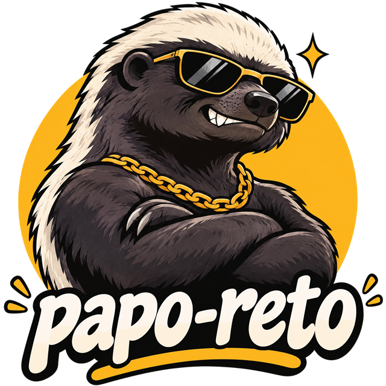

<div align="center">



# Papo Reto: skill de português claro para Claude Code, Codex e ChatGPT

**A IA fala com você do jeito que um piloto fala com a torre: curto, claro e sem duplo sentido.**


</div>

---

**Papo Reto é uma skill gratuita e de código aberto que faz o Claude Code, o Codex e o ChatGPT responderem em português do Brasil claro, curto e sem ambiguidade.** As regras vêm do ASD-STE100, o inglês técnico simplificado da aviação, adaptado ao português. A skill também organiza pedidos ditados, separa o que a IA testou do que ela supôs e troca parágrafos longos por tabelas e listas.

## O problema

A IA responde com parágrafos longos, termina com "deve estar funcionando" e mistura o que testou com o que supôs. Você relê três vezes e ainda não sabe o que fazer.

O Papo Reto resolve isso com regras de escrita que a IA segue em toda resposta. A base vem da aviação, onde uma frase lida errado pode derrubar um avião.

## Para quem é

- **Quem tem TDAH ou dificuldade de atenção**, e precisa da resposta na primeira linha.
- **Quem trabalha em vários projetos** e não tem tempo de reler.
- **Quem dita os pedidos por voz**, misturando objetivo, contexto e ideias soltas.
- **Quem escreve prompts, instruções para agentes e mensagens de erro** em português.

## Antes e depois

| ❌ Sem o Papo Reto | ✅ Com o Papo Reto |
|---|---|
| "Ótima pergunta! Dei uma otimizada geral e deve estar bem melhor agora!" | "A página carrega em 1,8 s. Antes: 6,2 s." |
| "Vale ressaltar que talvez seja interessante você estar verificando o .env." | "Adicione `API_KEY` no `.env`. Depois rode `npm run dev`." |
| "Já está tudo pronto!" | "✅ Feito e testado: o formulário envia. 🟡 Falta testar: a chegada na caixa de entrada." |
| A IA supõe a causa e já sai mexendo. | **Suposição:** a imagem está pesada. A IA mede antes de mexer. |

## Os 4 modos

| Modo | Quando entra | O que você recebe |
|---|---|---|
| 🎯 **Pedido** | Você dita um pedido com várias ideias misturadas. | 6 campos (Objetivo, Contexto, Entregável, Limites, Passos e Validação) e o trabalho já feito. |
| ✂️ **Reescrita** | Um prompt, erro ou instrução está confuso. | O mesmo texto, sem ambiguidade. |
| 💬 **Resposta** | Sempre. | Frases curtas, sujeito explícito, sem enrolação. |
| 📊 **Visual** | O conteúdo tem 3 ou mais partes ligadas. | Uma tabela, lista ou diagrama no lugar do parágrafo. |

## O que veio da aviação

| Na aviação | No Papo Reto |
|---|---|
| **Fraseologia padrão:** cada palavra de rádio tem um só sentido. | Símbolos fixos de estado: ✅ Feito · 🟡 Não verificado · ⬜ Pendente · ⛔ Bloqueado · ❌ Falhou |
| **Cotejamento:** o piloto repete a instrução antes de agir. | A IA repete o objetivo em 1 linha antes de um trabalho grande. |
| **Lista de verificação:** nada depende da memória. | Todo trabalho termina com uma validação. Sem teste, o estado é 🟡, nunca ✅. |
| **ASD-STE100:** uma palavra, um sentido. Voz ativa. Uma instrução por frase. | As mesmas regras, adaptadas ao português do Brasil. |

## Regras só do português

O inglês técnico não tem estes problemas. O português tem:

- **Sujeito escondido:** "Apagou o arquivo." Quem apagou?
- **"Seu" com dois donos:** "O agente avisou o usuário que seu arquivo falhou." De quem é o arquivo?
- **"-se" que esconde quem faz:** "Deve-se reiniciar." Quem deve?
- **Gerundismo:** "Vou estar enviando" vira "Vou enviar".
- **Certeza inventada:** "Pode ter falhado" nunca vira "Falhou".

## Como instalar no Claude Code

Funciona no app, no terminal e na extensão do VS Code.

```powershell
git clone https://github.com/ajbondstar/papo-reto.git "$env:USERPROFILE\.claude\skills\papo-reto"
```

Abra uma conversa nova. Para ativar numa conversa já aberta, digite `/papo-reto`.

**claude.ai:** compacte a pasta `papo-reto` em `.zip` e envie em **Configurações → Capacidades → Skills**.

## Como instalar no Codex

```powershell
git clone https://github.com/ajbondstar/papo-reto.git "$env:USERPROFILE\.codex\skills\papo-reto"
```

Para a skill valer em toda resposta, acrescente ao `AGENTS.md` global (`$env:USERPROFILE\.codex\AGENTS.md`) a linha: "Use a skill `papo-reto` em toda resposta."

## Como usar no ChatGPT

O ChatGPT não lê pastas de skill. Cole a versão resumida de [`chatgpt/instrucoes-personalizadas.md`](chatgpt/instrucoes-personalizadas.md) nas **Instruções personalizadas**.

| Onde | O que entra | Vale em toda conversa? |
|---|---|---|
| Claude Code | A skill inteira | Sim, com `CLAUDE.md` ou hook |
| claude.ai | A skill inteira | Sim, depois de ativada |
| Codex | A skill inteira | Sim, com `AGENTS.md` |
| ChatGPT | Um resumo de 10 regras | Sim, pelas Instruções personalizadas |

## Exemplos de pedido

```
Organiza meu pedido: <texto ditado>
Deixa claro este prompt: <texto>
Tira a ambiguidade desta mensagem de erro
Mostra isso em tabela
```

Veja mais em [`exemplos/antes-depois.md`](exemplos/antes-depois.md).

## Verificador automático de texto

Um verificador em Node, sem dependências, aponta 14 tipos de problema: ponto e vírgula, frase longa, gerundismo, mesóclise, muleta, adjetivo de venda e outros.

```powershell
node scripts/pts-lint.mjs SEU-ARQUIVO.md
node scripts/pts-lint.mjs --selftest
```

| Opção | Faz |
|---|---|
| `--json` | Saída estruturada. |
| `--baseline N` | Tolera N achados graves. |
| `--disable regra1,regra2` | Desliga regras. |
| `--selftest` | Executa os 19 casos de teste. |

O verificador nunca marca dúvida ("pode", "talvez") como erro. A dúvida faz parte da informação.

## Perguntas frequentes

### O que é uma skill do Claude Code?

Uma skill é uma pasta com um arquivo `SKILL.md` de instruções. O Claude Code e o Codex leem esse arquivo e seguem as regras dele. Instalar uma skill é copiar a pasta para o lugar certo.

### O Papo Reto funciona com o ChatGPT?

Sim, numa versão resumida. O ChatGPT não lê pastas de skill. Por isso, o repositório traz um texto de 10 regras para colar nas Instruções personalizadas.

### O que é o ASD-STE100?

É o Simplified Technical English, um padrão da indústria aeroespacial europeia criado em 1986. Ele limita palavras e frases para que um mecânico não leia errado uma instrução de manutenção. O Papo Reto adapta as regras dele ao português.

### O Papo Reto ajuda quem tem TDAH?

A skill foi criada para leitores com dificuldade de atenção. A resposta começa pela ação, as etapas vêm numeradas e cada mensagem termina com um próximo passo de até 2 minutos. A skill é uma ferramenta de escrita, não um tratamento.

### A IA fica com respostas secas demais?

Não deve. A regra é tirar a ambiguidade, não cortar palavra. A skill também não se aplica a texto criativo, de marketing ou persuasivo.

### Quanto custa?

Nada. O Papo Reto é gratuito e usa a licença MIT.

## Arquivos

| Arquivo | Conteúdo |
|---|---|
| `SKILL.md` | As regras. |
| `referencias/regras-de-escrita.md` | A origem de cada regra e o motivo da adaptação. |
| `referencias/guia-visual.md` | Quando usar tabela, lista, diagrama ou gráfico. |
| `exemplos/antes-depois.md` | Exemplos dos 4 modos. |
| `scripts/pts-lint.mjs` | O verificador. |
| `chatgpt/instrucoes-personalizadas.md` | A versão resumida para o ChatGPT. |
| `CHANGELOG.md` | O histórico de versões. |
| `CONTRIBUTING.md` | Como contribuir. |

## Limites

- O ASD-STE100 define só o inglês. Estas regras são uma adaptação, não uma norma oficial.
- A skill não reproduz o dicionário oficial da ASD.
- A skill corrige a forma do texto, não o conteúdo. Um texto vazio sai curto, claro e ainda vazio.

## English summary

**Papo Reto** is a free, open-source agent skill that makes Claude Code, OpenAI Codex and ChatGPT answer in clear, unambiguous Brazilian Portuguese. It adapts ASD-STE100 Simplified Technical English (the aviation controlled language) to Portuguese, adds fixed status and certainty labels, turns dictated requests into structured prompts, and ends every task with a validation step. Designed for readers with ADHD and anyone who works across many projects.

## Autor

**Allan Jorge Mendonça** · [@ajbondstar](https://github.com/ajbondstar)

## Licença

MIT. Veja [LICENSE](LICENSE). Inspirado no [asd-ste100-skill](https://github.com/danyuchn/asd-ste100-skill), também MIT.
